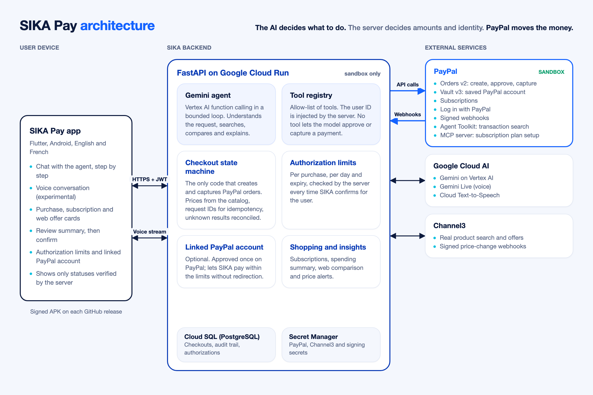

# SIKA Pay — Your AI. Your money. Your control.

> **PayPal AI Hackathon 2026 — "Build what's next with PayPal and AI"**
> A mobile AI payment agent that turns a purchase intent into a **real PayPal sandbox payment**, while the user keeps control of every step.

⚠️ **Sandbox only.** SIKA Pay talks exclusively to `api-m.sandbox.paypal.com`. The backend refuses any other PayPal environment, so no real money can move.

**Try it:** download the signed Android app from the [latest release](https://github.com/dav9fulldev/sika-agent/releases/latest) (`sika-pay.apk`, Android 7+, 64-bit). It connects to the hosted backend; you only need a PayPal **sandbox** buyer account to pay.

---

## The problem

People increasingly ask AI assistants to "just buy it". But an assistant that can spend money raises hard questions:

- *Did it pick the right product and the right price?*
- *Did it respect my budget?*
- *Did it actually pay, or only "prepare" something?*
- *Can a prompt trick it into paying more, paying twice, or paying for someone else?*

First-time digital payers, including the West African mobile-first users SIKA was originally built for, need an agent that **explains, checks and asks**, not one that silently spends.

## The solution

SIKA Pay is an **agentic checkout assistant** built on PayPal:

1. You say what you want, in English or French, for example *"Help me buy an Excel course without going over 50 dollars."* Nothing is scripted: Gemini interprets each request and decides which tools to call.
2. **Gemini** understands the intent, searches the catalog with a tool and asks a question when the request is ambiguous.
3. The agent **prepares** a checkout. The **backend** computes the price, checks your budget and refuses anything over it. The AI never chooses an amount.
4. You review a summary that shows the item, the price, the budget check, and what was *verified* versus *provided by you*.
5. You confirm (biometrics when the device supports them), **or** SIKA confirms for you if you granted it an authorization (see *Hybrid control*). Either way, the backend **creates the PayPal order**.
6. You **approve on PayPal** (sandbox buyer account), unless you linked your PayPal account to SIKA (see *Saved PayPal account*).
7. The backend **verifies with PayPal that the order is approved**, then **captures** the payment, on your return to the app, through the PayPal webhook, or when the app checks the status.
8. SIKA shows the **real capture status returned by PayPal**, and only calls a payment "paid" for a `COMPLETED` capture with the expected amount.

"Order created", "approved" and "captured" are always shown as **distinct states**.

### Two ways to shop

- **Partner store (paid in the app):** the full PayPal flow above, with server-side prices, your confirmation or authorization, PayPal approval, then capture. The store (`SIKA Demo Store`) is fictional demo data; the PayPal calls are real sandbox calls.
- **The web (compare, then buy on the merchant's site):** SIKA searches real products at real online merchants through **[Channel3](https://trychannel3.com)** and compares their offers (price, stock, new or used) within your budget. You open the offer and pay on the merchant's site. SIKA never claims it paid there.
- **Price alerts:** *"Tell me when these headphones drop below $50."* Channel3 sends signed webhooks when an offer's price or stock changes (Standard Webhooks signature checked, each event processed once). Alerts never buy anything.

### Hybrid control

By default you confirm every purchase yourself. In **Profile → SIKA authorization** you can let SIKA confirm purchases for you, within limits you choose: a maximum per purchase, a maximum per day, and a duration (24 hours, 7 days or 30 days). You can withdraw it at any time.

The agent's confirmation tool is **not even shown to the model** without an active authorization, and the **server** enforces the limits every time, whatever the AI says.

### Saved PayPal account (PayPal Vault)

Optional, and the user's choice. On the same screen you can **link your PayPal account once** (you approve it on PayPal):

- **Linked account + active authorization:** purchases SIKA confirms for you are paid with the saved account, **without leaving the app**, always within your limits.
- **No linked account:** you approve each payment on PayPal.
- Purchases you confirm yourself always go through PayPal approval.

SIKA stores only PayPal's token ID and a masked e-mail. Unlinking deletes the token at PayPal. If the network fails while paying with the saved account, the result is `UNKNOWN_RESULT` (never "nothing was paid") and SIKA reconciles it with the same `PayPal-Request-Id`, so it cannot charge twice.

### Subscriptions

*"Subscribe me to the cheapest music plan under $10 a month."* SIKA compares the demo store's monthly plans and prepares the chosen one after re-checking its price with PayPal. You confirm in the app, then approve on PayPal; the status comes from PayPal (return page and `BILLING.SUBSCRIPTION.*` webhooks), and you can cancel from **My subscriptions**. The plans were created with **PayPal's official MCP server** (`backend/scripts/paypal_seed_subscription_plans.py`); the user flow uses the Subscriptions REST API.

### Spending summary

*"How much did I spend this month, and on what?"* SIKA answers from your own payments whose capture was verified with PayPal (totals, categories, purchases it confirmed for you, active subscriptions), cross-checked with PayPal's transaction reports through the official **[PayPal Agent Toolkit](https://github.com/paypal/agent-toolkit)** (`list_transactions`). PayPal's reports contain every customer of the merchant, so the server keeps only your own payments before anything reaches the AI.

### Price and stock alerts that come to you

Every web product SIKA shows you is followed for 30 days through **Channel3 product subscriptions** (`offer.price.changed`, `offer.availability.changed`, `offer.created`, `offer.deleted`). When the best offer changes (price drop or increase, back in stock, out of stock, a cheaper merchant, an offer removed), SIKA tells you in the app and with a push notification (Firebase Cloud Messaging). Changes under 2% or $1 are ignored, at most one alert per product per day, nothing at night. Alerts never buy anything, and automatic following can be turned off in Settings.

### Web dashboard (AG Studio)

**Settings → Web dashboard** shows a single-use code; enter it at `/dashboard/` on a computer. The dashboard is built with **[AG Studio](https://www.ag-grid.com/studio/)**: your payments, the payment journey (prepared → waiting for PayPal → paid), your spending authorization, followed products and the changes SIKA noticed, in the SIKA Pay theme with two SIKA widgets of its own.

Its assistant uses the **Studio Agent Framework** with Gemini as the model: a SIKA agent leads the conversation and hands page work to Studio's built-in agents (planning, data, page, widget). *"What did SIKA pay for me?"* queries the data, filters the payments table and answers with the total. The browser never holds a model key (each turn goes through `/api/v1/dashboard/llm`, answered by Gemini on Vertex AI), and the dashboard session is read-only: its token is refused by every other API route, so nothing can be paid from the web.

### Voice (experimental)

Tap the microphone and talk naturally: SIKA answers out loud through **Gemini Live** (speech-to-speech), with the same tools and the same safety rules as the chat. It is still being tuned; the chat is the reference experience.

---

## What the AI actually does

| Responsibility | How |
|---|---|
| Understand intent, budget and quantity | Gemini (Vertex AI or Gemini API) with function calling |
| Find real products, never invented | `search_demo_catalog` (read-only) |
| Compare real merchants on the web | `search_web_products` (read-only, Channel3) |
| Ask when ambiguous | System policy + tests: several matches → it asks which one |
| Prepare, never pay | `prepare_paypal_checkout` (confirmation required): no PayPal call, no charge |
| Confirm only when you allowed it | `confirm_checkout_with_authorization`, shown to the model only under an active authorization; limits checked server-side |
| Summarize spending | `get_spending_summary` (read-only, cross-checked with the PayPal Agent Toolkit) |
| Report the real outcome | `get_paypal_checkout_status` re-checks PayPal (read-only) |
| Separate facts from assumptions | Every checkout carries `provenance.verified / user_provided / assumptions` |

**What the AI cannot do, by design:** capture a payment, pass an amount, act as another user, or confirm a purchase you did not authorize. The server always injects `user_id`, a bounded loop and an allow-list reject any other tool call, and tool results (such as web product titles) are treated as data, never as instructions.

If Gemini is unavailable, a **deterministic fallback** still handles purchase requests. It is labelled `SIKA_LOCAL_FALLBACK`, never claims to be AI, and never simulates a PayPal result.

---

## PayPal integration

| Feature | PayPal API | Safety |
|---|---|---|
| Auth | `POST /v1/oauth2/token` (client_credentials) | Token cached server-side, never logged |
| Log in with PayPal | `/connect` (OpenID Connect) → token → `GET /v1/identity/oauth2/userinfo` | Signed `state`, code exchanged server-side, verified PayPal account = verified identity |
| Create order | `POST /v2/checkout/orders` (`intent=CAPTURE`, `user_action=PAY_NOW`) | Only after a confirmation bound to a SHA-256 `details_hash`; stable `PayPal-Request-Id` |
| Verify approval | `GET /v2/checkout/orders/{id}` | Capture refused unless PayPal says `APPROVED` and the amount matches |
| Capture | `POST /v2/checkout/orders/{id}/capture` | Stable `PayPal-Request-Id`: a retry can never double-charge |
| Saved PayPal account | `POST /v3/vault/setup-tokens` → `POST /v3/vault/payment-tokens`, then orders with `payment_source.paypal.vault_id` | Approved by the payer on PayPal; used only under an active authorization, within its limits |
| Subscriptions | `/v1/billing/subscriptions` | Price re-checked with PayPal; user confirms and approves |
| Webhooks | `CHECKOUT.ORDER.APPROVED`, `PAYMENT.CAPTURE.*`, `BILLING.SUBSCRIPTION.*` | `POST /v1/notifications/verify-webhook-signature`, each event processed once, state re-read with `GET` |
| Transaction search | Agent Toolkit `list_transactions` (`/v1/reporting/transactions`) | Read-only, filtered to the user's own captures |
| Plan setup | PayPal MCP server | Merchant-side setup script only |

Errors follow PayPal's [payment-failure guide](https://developer.paypal.com/api/handle-payment-failures): back to PayPal to choose another funding source (`INSTRUMENT_DECLINED`, `PAYER_ACTION_REQUIRED`…), declined with a specific message (`PAYER_CANNOT_PAY`, `TRANSACTION_REFUSED`…), expired orders (404), `ORDER_ALREADY_CAPTURED` (never a second capture), and timeouts → `UNKNOWN_RESULT`, never a fake success. Pending captures, refunds and payer cancellation are handled too.

```
AWAITING_USER_CONFIRMATION → CREATING_ORDER → AWAITING_PAYPAL_APPROVAL → APPROVED → CAPTURING → COMPLETED
          │                        │                 │                       │            ├→ PENDING / DECLINED / FAILED
          └→ CANCELLED / EXPIRED   │                 └→ CANCELLED / EXPIRED  └→ CANCELLED └→ UNKNOWN_RESULT (verify, safe retry)
                                   └→ COMPLETED directly with a saved PayPal account (or UNKNOWN_RESULT, then reconciled)
```

Every transition is written to an append-only audit trail, which the app shows in the receipt.

---

## Architecture



| Layer | Technology |
|---|---|
| Mobile | Flutter 3 / Dart, Riverpod, local_auth (biometrics), url_launcher, record + PCM playback (voice), ML Kit text recognition (identity documents) |
| Backend | Python 3.11+, FastAPI, SQLAlchemy 2 + Alembic, Google Cloud Run, Cloud SQL (PostgreSQL), Secret Manager |
| AI | Gemini via `google-genai` (Vertex AI ADC **or** `GEMINI_API_KEY`), Gemini Live (voice), Cloud Text-to-Speech |
| Payments | PayPal REST API (sandbox): Orders v2, Vault v3, Subscriptions, Identity, Webhooks, Transaction Search; PayPal Agent Toolkit; PayPal MCP server |
| Shopping | Channel3 product API and webhooks |

Key files:

- `backend/app/services/wallet_integrations/paypal_api_service.py`: PayPal REST client (orders, vault, subscriptions, webhooks)
- `backend/app/services/paypal_checkout_service.py`: checkout state machine, the only code that creates and captures PayPal orders
- `backend/app/services/paypal_vault_service.py`: saved PayPal account (link, unlink)
- `backend/app/services/agent_mandate_service.py`: hybrid control (authorization limits)
- `backend/app/services/spending_service.py` + `wallet_integrations/paypal_agent_toolkit.py`: spending summary
- `backend/app/services/sika_ai.py`: Gemini agent loop and deterministic fallback
- `backend/app/services/sika_voice_live.py`: voice bridge (Gemini Live)
- `backend/app/agent/tools/commerce_tools.py`: agent tools with strict schemas
- `mobile/lib/features/paypal/`: home, checkout flow, authorization, history, cards

---

## Quick start

The easiest path is the [Android app](https://github.com/dav9fulldev/sika-agent/releases/latest), which uses the hosted backend. To run everything yourself:

### 1. PayPal sandbox credentials (5 minutes)

Follow **[docs/PAYPAL_SANDBOX_SETUP.md](docs/PAYPAL_SANDBOX_SETUP.md)**: create a sandbox REST app, copy its client ID and secret, and note a sandbox **buyer** account.

### 2. Backend

```bash
cd backend
python3 -m venv venv && source venv/bin/activate
pip install -r requirements.txt
pip install --no-deps paypal-agent-toolkit==1.11.0   # core only, as in the Dockerfile
cp .env.example .env
# Edit .env:
#   PAYPAL_CLIENT_ID=...       (sandbox)
#   PAYPAL_CLIENT_SECRET=...   (sandbox)
#   PUBLIC_BASE_URL=http://<your-LAN-IP>:8001   (reachable from the phone)
#   AI: either GEMINI_API_KEY=...  or  `gcloud auth application-default login` + GOOGLE_CLOUD_PROJECT
#   Optional: CHANNEL3_API_KEY (web shopping), GOOGLE_CLIENT_ID (Google sign-in)
alembic upgrade head
uvicorn app.main:app --host 0.0.0.0 --port 8001
```

Check it: `curl http://localhost:8001/api/v1/paypal/status` returns `"configured": true` and `"environment": "sandbox"`, and no secret.

Docker alternative: `docker compose up --build` (it reads `backend/.env`).

### 3. Mobile app (Android)

```bash
cd mobile
flutter pub get
flutter run --dart-define=SIKA_API_URL=http://<your-LAN-IP>:8001   # physical phone
# emulator: --dart-define=SIKA_API_URL=http://10.0.2.2:8001
```

Sign in (e-mail, Google or **PayPal**), open **Assistant**, and ask for something in your own words. The app is in English by default; French is available in the settings.

Optional, for asynchronous updates: register the webhook once with `cd backend && python scripts/paypal_register_webhook.py https://<public-backend-url>`.

### 4. Real sandbox end-to-end check without the app

```bash
cd backend && python scripts/paypal_sandbox_e2e.py
```

The script creates a real sandbox order and prints the approval link. Approve it with the buyer account, and the script verifies `APPROVED`, captures, checks the amount and confirms that a second capture is refused.

---

## Tests

```bash
cd backend && pip install -r requirements-dev.txt && python -m pytest tests -q   # 242 tests, no network
cd mobile && flutter analyze && flutter test                                     # 0 issues, 31 tests
cd dashboard && npm ci && npm run lint && npm run build                          # web dashboard
```

CI (GitHub Actions) runs the backend, mobile and dashboard checks on every pull request, and a failing backend test blocks the Cloud Run deployment. Each release also builds and attaches the signed Android APK.

The suites cover server-side pricing, budget refusal, confirmation binding and tampering, cross-user isolation, idempotent creation and capture, no capture before approval, network failures → `UNKNOWN_RESULT`, declines, pending captures, amount mismatches, the sandbox-only configuration, the tool allow-list, rejection of model-supplied amounts and `user_id` spoofing, the bounded agent loop, authorization limits, the saved PayPal account (never used without authorization or above the limits, reconciliation without double charge), webhook signatures and deduplication, the spending summary (only the user's own payments), the voice bridge, and the sign-in protections. Unit tests use test doubles of PayPal, Gemini and Channel3 and never call the network.

Verified against the real PayPal sandbox:

- `scripts/paypal_sandbox_e2e.py`: order created, buyer approval, `APPROVED` verified, capture `COMPLETED`, second capture refused.
- On a device against the deployed backend: Log in with PayPal, a purchase confirmed by the user, a purchase confirmed by SIKA under an authorization, a purchase refused above the limit, a cancellation on PayPal, and a purchase paid with a saved PayPal account without redirection (PayPal reports the order and capture as `COMPLETED`).

## API

| Method | Endpoint | Auth |
|---|---|---|
| GET | `/api/v1/paypal/status` | – |
| GET / POST | `/api/v1/sika/auth/paypal/start` · `/api/v1/sika/auth/paypal` (Log in with PayPal) | – |
| POST | `/api/v1/sika/chat` | JWT |
| WebSocket | `/api/v1/sika/voice/live` (voice; token in the first message) | JWT |
| POST | `/api/v1/paypal/checkouts` (prepare: sku, quantity, budget) | JWT |
| GET | `/api/v1/paypal/checkouts` · `/{id}?sync=true` | JWT |
| POST | `/api/v1/paypal/checkouts/{id}/confirm` · `/capture` · `/cancel` | JWT |
| GET / PUT / DELETE | `/api/v1/paypal/agent-authorization` (hybrid control) | JWT |
| GET / POST / DELETE | `/api/v1/paypal/vault` (saved PayPal account) | JWT |
| GET / POST | `/api/v1/paypal/subscriptions` · `/{ref}` · `/{ref}/confirm` · `/{ref}/cancel` | JWT |
| POST | `/api/v1/paypal/webhook` | PayPal signature |
| GET / POST / DELETE | `/api/v1/shopping/price-watches` | JWT |
| POST | `/api/v1/shopping/channel3/webhook` | Svix signature |
| GET / POST | `/api/v1/notifications` · `/read` · `/devices` · `/devices/remove` · `/preferences` | JWT |
| POST | `/api/v1/dashboard/code` (single-use code for the web dashboard) | JWT |
| POST | `/api/v1/dashboard/session` (code → read-only dashboard token) | code |
| GET / POST | `/api/v1/dashboard/config` · `/data` · `/llm` | dashboard token |
| GET | `/api/v1/paypal/return` · `/cancel` · `/vault-return` · `/vault-cancel` (PayPal redirects, server-verified) | – |

## Known limitations

- **Demo merchant.** The catalog (`SIKA Demo Store`) is fictional, with digital goods only. The PayPal calls are real sandbox calls.
- **Single currency (USD).** SIKA never converts currencies; a budget in another currency triggers a clarification.
- **No PayPal balance.** Orders v2 does not expose a buyer balance, so SIKA shows the connection status instead of inventing one.
- **Voice is experimental**, and subscriptions are in beta.
- **PayPal transaction reports lag** behind live payments in the sandbox; the spending summary says so when a recent payment is not listed yet.
- Accounts created with PayPal or Google have no SIKA password: sign in again with the same button.
- Running the AI requires a Gemini API key or Google Cloud ADC. Without it, the deterministic fallback is used and labelled as such.

## Project history

SIKA started at the Google "All Things Agentic" hackathon (August 2026) as a Mobile Money assistant for West African users, with a voice and chat assistant, a Gemini agent and a FastAPI backend.

**Built during the PayPal AI Hackathon submission period (from October 1, 2026):**

- The whole payment layer was replaced by PayPal (Orders v2, sandbox); the Mobile Money integration was removed.
- Agentic commerce with server-side pricing and budget checks, hybrid control, and the saved PayPal account (Vault).
- Auto-capture after PayPal approval, signed PayPal webhooks, and PayPal error handling.
- Log in with PayPal, subscriptions, the spending summary with the PayPal Agent Toolkit, and the PayPal MCP server for plan setup.
- Web comparison and price alerts with Channel3, and natural voice conversations with Gemini Live (experimental).
- A new mobile experience in English and French, a security review with fixes, CI, and signed Android releases.

See [CHANGELOG.md](CHANGELOG.md) for the details.

## Security

See [SECURITY.md](SECURITY.md).

## License

[MIT](LICENSE) © 2026 Brou David Yao
