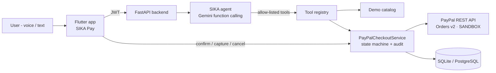

# SIKA Pay — Your AI. Your money. Your control.

> **PayPal AI Hackathon 2026 — "Build what's next with PayPal and AI"**
> A mobile AI payment agent that turns a purchase intent into a **real PayPal sandbox payment**, while the user keeps control of every step.

⚠️ **Sandbox only.** SIKA Pay talks exclusively to `api-m.sandbox.paypal.com`. The backend refuses any other PayPal environment, so no real money can move.

---

## The problem

People increasingly ask AI assistants to "just buy it". But an assistant that can spend money raises hard questions:

- *Did it pick the right product and the right price?*
- *Did it respect my budget?*
- *Did it actually pay, or only "prepare" something?*
- *Can a prompt trick it into paying more, paying twice, or paying for someone else?*

First-time digital payers, including the West African mobile-first users SIKA was originally built for, need an agent that **explains, checks and asks**, not one that silently spends.

## The solution

SIKA Pay is an **agentic checkout assistant** built on PayPal Orders v2:

1. You say what you want, for example *"Help me buy an Excel course without going over 50 dollars."*
2. **Gemini** understands the intent, searches the catalog with a tool and asks a question when the request is ambiguous.
3. The agent **prepares** a checkout. The **backend** computes the price, checks your budget and refuses anything over it. The AI never chooses an amount.
4. You review a confirmation screen that shows the item, the price, the budget check, and what was *verified* versus *provided by you*.
5. On your explicit confirmation, which uses biometrics when the device supports them, the backend **creates the PayPal order**.
6. You **approve on PayPal** (sandbox buyer account).
7. Back in SIKA, the backend **verifies with PayPal that the order is APPROVED**. You then tap **"Pay now"**, and it **captures** the payment.
8. SIKA shows and explains the **real capture status returned by PayPal**: order ID, capture ID and captured amount.

"Order created", "approved" and "captured" are always shown as **distinct states**.

---

## What the AI actually does

| Responsibility | How |
|---|---|
| Understand intent, budget and quantity | Gemini 3.5 Flash (Vertex AI or Gemini API) with function calling |
| Find real products, never invented | `search_demo_catalog` tool (READ_ONLY) |
| Ask when ambiguous | System policy + tests: several matches → it asks which one |
| Prepare, never pay | `prepare_paypal_checkout` tool (CONFIRMATION_REQUIRED): no PayPal call, no charge |
| Explain over-budget refusals and offer alternatives | Backend returns `OVER_BUDGET` + alternatives; Gemini explains them |
| Report the real outcome | `get_paypal_checkout_status` re-checks PayPal (read-only) |
| Separate facts from assumptions | Every checkout carries `provenance.verified / user_provided / assumptions` |

**What the AI cannot do, by design:** create a PayPal order, capture a payment, pass an amount, or act as another user. These operations are not tools. They exist only as authenticated user actions, and the server always injects `user_id`. A bounded ReAct loop (5 steps) and an allow-list reject any other tool call.

If Gemini is unavailable, a **deterministic fallback** still handles purchase requests. It is labelled `SIKA_LOCAL_FALLBACK`, never claims to be AI, and never simulates a PayPal result.

---

## PayPal integration

| Step | PayPal API | Safety |
|---|---|---|
| Auth | `POST /v1/oauth2/token` (client_credentials) | Token cached server-side, never logged |
| Create order | `POST /v2/checkout/orders` (`intent=CAPTURE`, items + breakdown, `NO_SHIPPING`, `user_action=CONTINUE`) | Only after user confirmation bound to a SHA-256 `details_hash`; stable `PayPal-Request-Id` |
| Verify approval | `GET /v2/checkout/orders/{id}` | Capture refused unless PayPal says `APPROVED` and the amount matches |
| Capture | `POST /v2/checkout/orders/{id}/capture` | Stable `PayPal-Request-Id` → a retry can never double-charge |
| Result | `purchase_units[].payments.captures[]` | `COMPLETED` only if captured amount and currency equal the confirmed ones |

Handled outcomes include `PAYER_ACTION_REQUIRED`, `ORDER_NOT_APPROVED`, `INSTRUMENT_DECLINED` (back to PayPal), `ORDER_ALREADY_CAPTURED`, `DECLINED`, `PENDING`, expired or unknown orders (404), payer cancellation, timeouts (`UNKNOWN_RESULT`, never a fake success) and amount mismatches.

```
AWAITING_USER_CONFIRMATION → CREATING_ORDER → AWAITING_PAYPAL_APPROVAL → APPROVED → CAPTURING → COMPLETED
          │                                          │                       │            ├→ PENDING / DECLINED / FAILED
          └→ CANCELLED / EXPIRED                     └→ CANCELLED / EXPIRED  └→ CANCELLED └→ UNKNOWN_RESULT (verify, safe retry)
```

Every transition is written to an append-only audit trail, which the app shows in the receipt.

---

## Architecture



| Layer | Technology |
|---|---|
| Mobile | Flutter 3 / Dart, Riverpod, local_auth (biometrics), url_launcher, speech_to_text / TTS |
| Backend | Python 3.11+, FastAPI, SQLAlchemy 2 + Alembic, `requests` |
| AI | Google Gemini 3.5 Flash via `google-genai` (Vertex AI ADC **or** `GEMINI_API_KEY`) |
| Payments | PayPal REST API — Orders v2, sandbox |

Key files:

- `backend/app/services/wallet_integrations/paypal_api_service.py`: PayPal REST client
- `backend/app/services/paypal_checkout_service.py`: state machine, validation, idempotency, audit
- `backend/app/routes/paypal_router.py`: `/api/v1/paypal/*`
- `backend/app/agent/tools/commerce_tools.py`: agent tools with strict schemas
- `backend/app/services/sika_ai.py`: Gemini agent loop and deterministic fallback
- `mobile/lib/features/paypal/`: home, checkout flow, history, checkout card

---

## Quick start

### 1. PayPal sandbox credentials (5 minutes)

Follow **[docs/PAYPAL_SANDBOX_SETUP.md](docs/PAYPAL_SANDBOX_SETUP.md)**: create a sandbox REST app and copy its client ID and secret, then note a sandbox **buyer** account.

### 2. Backend

```bash
cd backend
python3 -m venv venv && source venv/bin/activate
pip install -r requirements.txt
cp .env.example .env
# Edit .env:
#   PAYPAL_CLIENT_ID=...       (sandbox)
#   PAYPAL_CLIENT_SECRET=...   (sandbox)
#   PUBLIC_BASE_URL=http://<your-LAN-IP>:8001   (reachable from the phone)
#   AI: either GEMINI_API_KEY=...  or  `gcloud auth application-default login` + GOOGLE_CLOUD_PROJECT
uvicorn app.main:app --host 0.0.0.0 --port 8001
```

Check it: `curl http://localhost:8001/api/v1/paypal/status`. It returns `"configured": true` and `"environment": "sandbox"`, and no secret.

Docker alternative: `docker compose up --build` (it reads `backend/.env`).

### 3. Mobile app (Android)

```bash
cd mobile
flutter pub get
flutter run --dart-define=SIKA_API_URL=http://<your-LAN-IP>:8001   # physical phone
# emulator: --dart-define=SIKA_API_URL=http://10.0.2.2:8001
```

Create an account in the app, open **Assistant**, and ask: *"Help me buy an Excel course without going over 50 dollars."*

### 4. Real sandbox end-to-end check without the app

```bash
cd backend && python scripts/paypal_sandbox_e2e.py
```

The script creates a real sandbox order and prints the approval link. Approve it with the buyer account, and the script verifies `APPROVED`, captures, checks the amount and confirms that a second capture is refused.

---

## Tests

```bash
cd backend && source venv/bin/activate && pytest -q      # 130 tests, no network, ~15 s
cd mobile && flutter analyze && flutter test               # 0 issues, 12 tests
```

The PayPal suites (`test_paypal_checkout.py`, `test_paypal_api_service.py`, `test_paypal_agent.py`) cover server-side pricing, budget refusal, confirmation binding and tampering, cross-user isolation, idempotent creation and capture, no capture before approval, network failure → `UNKNOWN_RESULT`, declines, pending captures, amount mismatches, the sandbox-only configuration, the tool allow-list, rejection of model-supplied amounts and `user_id` spoofing, and the bounded agent loop. Unit tests use a test double of the PayPal API and never call the network. The real sandbox flow is exercised by `scripts/paypal_sandbox_e2e.py`.

## API

| Method | Endpoint | Auth |
|---|---|---|
| GET | `/api/v1/paypal/status` | – |
| POST | `/api/v1/sika/chat` | JWT |
| POST | `/api/v1/paypal/checkouts` (prepare: sku, quantity, budget) | JWT |
| GET | `/api/v1/paypal/checkouts` · `/{id}?sync=true` | JWT |
| POST | `/api/v1/paypal/checkouts/{id}/confirm` · `/capture` · `/cancel` | JWT |
| GET | `/api/v1/paypal/return` · `/cancel` (PayPal redirects, server-verified) | – |

## Known limitations

- **Demo merchant.** The catalog (`SIKA Demo Store`) is fictional demo data with digital goods only. The PayPal calls are real sandbox calls.
- **No PayPal balance.** Orders v2 does not expose a buyer balance, so SIKA shows the connection status instead of inventing one.
- **Single currency (USD).** SIKA never converts currencies; a budget in another currency triggers a clarification.
- Approval happens in the external browser. The app re-checks the status when you come back, through the app lifecycle or the "I've approved — check" button.
- Running the AI requires a Gemini API key or Google Cloud ADC. Without it, the deterministic fallback is used and labelled as such.

## Project history

SIKA started at the Google "All Things Agentic" hackathon (August 2026) as a Mobile Money assistant. For this hackathon, the payment layer was rebuilt around PayPal. See [docs/HACKATHON_PROGRESS.md](docs/HACKATHON_PROGRESS.md) for what existed before and what was built during the submission period.

## License

[MIT](LICENSE) © 2026 Brou David Yao
