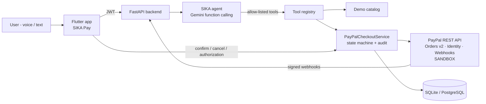

# SIKA Pay — Your AI. Your money. Your control.

> **PayPal AI Hackathon 2026 — "Build what's next with PayPal and AI"**
> A mobile AI payment agent that turns a purchase intent into a **real PayPal sandbox payment**, while the user keeps control of every step.

⚠️ **Sandbox only.** SIKA Pay talks exclusively to `api-m.sandbox.paypal.com`. The backend refuses any other PayPal environment, so no real money can move.

---

## The problem

People increasingly ask AI assistants to "just buy it". But an assistant that can spend money raises hard questions:

- *Did it pick the right product and the right price?*
- *Did it respect my budget?*
- *Did it actually pay, or only "prepare" something?*
- *Can a prompt trick it into paying more, paying twice, or paying for someone else?*

First-time digital payers, including the West African mobile-first users SIKA was originally built for, need an agent that **explains, checks and asks**, not one that silently spends.

## The solution

SIKA Pay is an **agentic checkout assistant** built on PayPal Orders v2:

1. You say what you want, for example *"Help me buy an Excel course without going over 50 dollars."*
2. **Gemini** understands the intent, searches the catalog with a tool and asks a question when the request is ambiguous.
3. The agent **prepares** a checkout. The **backend** computes the price, checks your budget and refuses anything over it. The AI never chooses an amount.
4. You review a confirmation screen that shows the item, the price, the budget check, and what was *verified* versus *provided by you*.
5. You confirm (biometrics when the device supports them), **or** SIKA confirms for you if you granted it an authorization (see *Hybrid control* below). Either way, the backend **creates the PayPal order**.
6. You **approve on PayPal** (sandbox buyer account). This is always your decision.
7. The backend **verifies with PayPal that the order is APPROVED**, then **captures** the payment right away, as in the standard PayPal flow. It does this on your return to the app, through the PayPal webhook, or when the app checks the status.
8. SIKA shows and explains the **real capture status returned by PayPal**: order ID, capture ID and captured amount.

"Order created", "approved" and "captured" are always shown as **distinct states**.

### Hybrid control

By default you confirm every purchase yourself. In **Profile → SIKA authorization** you can let SIKA confirm purchases for you, within limits you choose:

- a maximum per purchase,
- a maximum per day,
- a duration (24 hours, 7 days or 30 days).

You can withdraw it at any time. The agent's confirmation tool is **not even shown to the model** without an active authorization, and the **server** enforces the limits, not the AI. PayPal approval by the payer is still required, and no tool can capture a payment.

---

## What the AI actually does

| Responsibility | How |
|---|---|
| Understand intent, budget and quantity | Gemini 3.5 Flash (Vertex AI or Gemini API) with function calling |
| Find real products, never invented | `search_demo_catalog` tool (READ_ONLY) |
| Ask when ambiguous | System policy + tests: several matches → it asks which one |
| Prepare, never pay | `prepare_paypal_checkout` tool (CONFIRMATION_REQUIRED): no PayPal call, no charge |
| Confirm only when you allowed it | `confirm_checkout_with_authorization` tool, shown to the model only under an active user authorization; per-purchase, daily and expiry limits checked server-side |
| Explain over-budget refusals and offer alternatives | Backend returns `OVER_BUDGET` + alternatives; Gemini explains them |
| Report the real outcome | `get_paypal_checkout_status` re-checks PayPal (read-only) |
| Separate facts from assumptions | Every checkout carries `provenance.verified / user_provided / assumptions` |

**What the AI cannot do, by design:** capture a payment, pass an amount, act as another user, or confirm a purchase you did not authorize. Capture is not a tool: it only follows the payer's approval, verified with PayPal. The server always injects `user_id`. A bounded ReAct loop (5 steps) and an allow-list reject any other tool call.

If Gemini is unavailable, a **deterministic fallback** still handles purchase requests. It is labelled `SIKA_LOCAL_FALLBACK`, never claims to be AI, and never simulates a PayPal result.

---

## PayPal integration

| Step | PayPal API | Safety |
|---|---|---|
| Auth | `POST /v1/oauth2/token` (client_credentials) | Token cached server-side, never logged |
| Log in with PayPal | `/connect` (OpenID Connect) → `POST /v1/oauth2/token` (authorization_code) → `GET /v1/identity/oauth2/userinfo` | Signed `state`, code exchanged server-side, account linked by payer ID, verified PayPal account = verified identity |
| Create order | `POST /v2/checkout/orders` (`intent=CAPTURE`, items + breakdown, `NO_SHIPPING`, `user_action=CONTINUE`) | Only after user confirmation bound to a SHA-256 `details_hash`; stable `PayPal-Request-Id` |
| Verify approval | `GET /v2/checkout/orders/{id}` | Capture refused unless PayPal says `APPROVED` and the amount matches |
| Capture | `POST /v2/checkout/orders/{id}/capture` | Stable `PayPal-Request-Id` → a retry can never double-charge |
| Result | `purchase_units[].payments.captures[]` | `COMPLETED` only if captured amount and currency equal the confirmed ones |
| Webhooks | `CHECKOUT.ORDER.APPROVED`, `PAYMENT.CAPTURE.COMPLETED / PENDING / DENIED / DECLINED / REFUNDED / REVERSED` | Signature checked with `POST /v1/notifications/verify-webhook-signature`, each event processed once, state always re-read with `GET` order |

Errors follow PayPal's [payment-failure guide](https://developer.paypal.com/api/handle-payment-failures):

- **Back to PayPal to choose another funding source:** `INSTRUMENT_DECLINED`, `REDIRECT_PAYER_FOR_ALTERNATE_FUNDING`, `PAYER_ACTION_REQUIRED`, `ORDER_NOT_APPROVED`.
- **Declined with a specific message:** `PAYER_CANNOT_PAY`, `TRANSACTION_REFUSED`, `MAX_NUMBER_OF_PAYMENT_ATTEMPTS_EXCEEDED`, `CANNOT_PAY_SELF`, `CURRENCY_NOT_SUPPORTED` and similar.
- **Expired:** an order PayPal no longer knows (404, `INVALID_RESOURCE_ID`).
- **Never a second capture:** `ORDER_ALREADY_CAPTURED`.
- **`UNKNOWN_RESULT`, never a fake success:** timeouts.
- **Also handled:** pending captures, refunds and payer cancellation.

```
AWAITING_USER_CONFIRMATION → CREATING_ORDER → AWAITING_PAYPAL_APPROVAL → APPROVED → CAPTURING → COMPLETED
          │                                          │                       │            ├→ PENDING / DECLINED / FAILED
          └→ CANCELLED / EXPIRED                     └→ CANCELLED / EXPIRED  └→ CANCELLED └→ UNKNOWN_RESULT (verify, safe retry)
```

Every transition is written to an append-only audit trail, which the app shows in the receipt.

---

## Architecture



| Layer | Technology |
|---|---|
| Mobile | Flutter 3 / Dart, Riverpod, local_auth (biometrics), url_launcher, speech_to_text / TTS |
| Backend | Python 3.11+, FastAPI, SQLAlchemy 2 + Alembic, `requests` |
| AI | Google Gemini 3.5 Flash via `google-genai` (Vertex AI ADC **or** `GEMINI_API_KEY`) |
| Payments | PayPal REST API — Orders v2, sandbox |

Key files:

- `backend/app/services/wallet_integrations/paypal_api_service.py`: PayPal REST client
- `backend/app/services/paypal_checkout_service.py`: state machine, validation, idempotency, auto-capture, webhooks, audit
- `backend/app/services/agent_mandate_service.py`: hybrid control (user authorization limits)
- `backend/app/services/paypal_identity_service.py`: Log in with PayPal
- `backend/app/routes/paypal_router.py`: `/api/v1/paypal/*`
- `backend/app/agent/tools/commerce_tools.py`: agent tools with strict schemas
- `backend/app/services/sika_ai.py`: Gemini agent loop and deterministic fallback
- `mobile/lib/features/paypal/`: home, checkout flow, history, checkout card

---

## Quick start

### 1. PayPal sandbox credentials (5 minutes)

Follow **[docs/PAYPAL_SANDBOX_SETUP.md](docs/PAYPAL_SANDBOX_SETUP.md)**: create a sandbox REST app and copy its client ID and secret, then note a sandbox **buyer** account.

### 2. Backend

```bash
cd backend
python3 -m venv venv && source venv/bin/activate
pip install -r requirements.txt
cp .env.example .env
# Edit .env:
#   PAYPAL_CLIENT_ID=...       (sandbox)
#   PAYPAL_CLIENT_SECRET=...   (sandbox)
#   PUBLIC_BASE_URL=http://<your-LAN-IP>:8001   (reachable from the phone)
#   AI: either GEMINI_API_KEY=...  or  `gcloud auth application-default login` + GOOGLE_CLOUD_PROJECT
uvicorn app.main:app --host 0.0.0.0 --port 8001
```

Check it: `curl http://localhost:8001/api/v1/paypal/status`. It returns `"configured": true` and `"environment": "sandbox"`, and no secret.

Docker alternative: `docker compose up --build` (it reads `backend/.env`).

### 3. Mobile app (Android)

```bash
cd mobile
flutter pub get
flutter run --dart-define=SIKA_API_URL=http://<your-LAN-IP>:8001   # physical phone
# emulator: --dart-define=SIKA_API_URL=http://10.0.2.2:8001
```

Sign in (e-mail, Google or **PayPal**), open **Assistant**, and ask: *"Help me buy an Excel course without going over 50 dollars."* The app is in English by default; French is available in the settings.

Optional, for asynchronous updates: register the webhook once with `cd backend && python scripts/paypal_register_webhook.py https://<public-backend-url>` (see the setup guide).

### 4. Real sandbox end-to-end check without the app

```bash
cd backend && python scripts/paypal_sandbox_e2e.py
```

The script creates a real sandbox order and prints the approval link. Approve it with the buyer account, and the script verifies `APPROVED`, captures, checks the amount and confirms that a second capture is refused.

---

## Tests

```bash
cd backend && pip install -r requirements-dev.txt && python -m pytest tests -q   # 166 tests, no network to PayPal
cd mobile && flutter analyze && flutter test                                     # 0 issues, 23 tests
```

CI (GitHub Actions) runs both suites on every pull request. A failing backend test blocks the Cloud Run deployment.

The PayPal suites (`test_paypal_checkout.py`, `test_paypal_api_service.py`, `test_paypal_agent.py`) cover server-side pricing, budget refusal, confirmation binding and tampering, cross-user isolation, idempotent creation and capture, no capture before approval, network failure → `UNKNOWN_RESULT`, declines, pending captures, amount mismatches, the sandbox-only configuration, the tool allow-list, rejection of model-supplied amounts and `user_id` spoofing, the bounded agent loop, the hybrid authorization limits, webhook signature checks and deduplication, and the PayPal error mapping. Unit tests use a test double of the PayPal API and never call the network. The real sandbox flow is exercised by `scripts/paypal_sandbox_e2e.py`. It **passed on 2026-10-24**: order created, buyer approval, `APPROVED` verified, capture `COMPLETED` 49.00 USD, and a second capture refused. On 2026-10-27, Log in with PayPal and an in-app purchase also passed against the deployed backend: order `5VN16317FJ728053P`, capture `COMPLETED` 49.00 USD, checked independently with PayPal.

## API

| Method | Endpoint | Auth |
|---|---|---|
| GET | `/api/v1/paypal/status` | – |
| GET / POST | `/api/v1/sika/auth/paypal/start` · `/api/v1/sika/auth/paypal` (Log in with PayPal) | – |
| POST | `/api/v1/sika/chat` | JWT |
| POST | `/api/v1/paypal/checkouts` (prepare: sku, quantity, budget) | JWT |
| GET | `/api/v1/paypal/checkouts` · `/{id}?sync=true` | JWT |
| POST | `/api/v1/paypal/checkouts/{id}/confirm` · `/capture` · `/cancel` | JWT |
| GET / PUT / DELETE | `/api/v1/paypal/agent-authorization` (hybrid control) | JWT |
| POST | `/api/v1/paypal/webhook` (PayPal, signature-verified) | PayPal signature |
| GET | `/api/v1/paypal/return` · `/cancel` (PayPal redirects, server-verified) | – |

## Known limitations

- **Demo merchant.** The catalog (`SIKA Demo Store`) is fictional demo data with digital goods only. The PayPal calls are real sandbox calls.
- **No PayPal balance.** Orders v2 does not expose a buyer balance, so SIKA shows the connection status instead of inventing one.
- **Single currency (USD).** SIKA never converts currencies; a budget in another currency triggers a clarification.
- Approval happens in the external browser. Capture then happens server-side, when you return to the app or through the webhook.
- Accounts created with PayPal or Google have no SIKA password: sign in again with the same button.
- Running the AI requires a Gemini API key or Google Cloud ADC. Without it, the deterministic fallback is used and labelled as such.

## Project history

SIKA started at the Google "All Things Agentic" hackathon (August 2026) as a Mobile Money assistant for West African users. It had a voice and chat assistant, a Gemini agent and a FastAPI backend.

**Built during the PayPal AI Hackathon submission period (from October 1, 2026):**

- The whole payment layer was replaced by PayPal Orders v2 (sandbox), and the Mobile Money integration was removed.
- An agentic commerce flow with server-side pricing and budget checks, plus hybrid control (user-granted authorization).
- Auto-capture after PayPal approval, signed PayPal webhooks, and PayPal error handling.
- Log in with PayPal, with verified identity.
- A new mobile experience in English and French.
- Security fixes and CI.

See [CHANGELOG.md](CHANGELOG.md) for the details.

## Security

See [SECURITY.md](SECURITY.md).

## License

[MIT](LICENSE) © 2026 Brou David Yao
