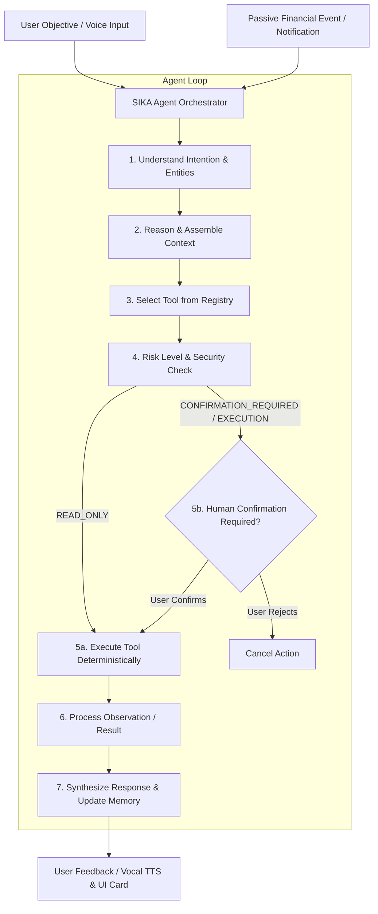
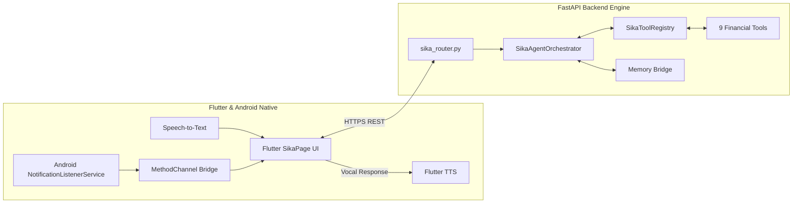

# SIKA — Autonomous Personal Financial Agent (Mobile Money)

**SIKA** is an autonomous personal financial agent built specifically for the Mobile Money ecosystem (Wave, Orange Money, MTN) in Francophone West Africa (Côte d'Ivoire, FCFA). 

Developed for the **All Things Agentic Hackathon** under the **Taskmaster** track, SIKA transforms how users manage, observe, and interact with their financial lives on mobile devices.

---

## About

In emerging markets like West Africa, financial transactions are heavily fragmented across multiple Mobile Money wallets (Wave, Orange Money, MTN Mobile Money) and bank SMS notifications. Users face significant friction:
- **Wallet Fragmentation**: Cash is spread across multiple apps with no unified balance view.
- **Tracking Overhead**: Manually calculating total funds or reviewing recent transactions across multiple apps is tedious.
- **Passivity of Existing Tools**: Traditional budgeting tools and chatbots are purely passive. They can answer basic questions but cannot reason, plan, or safely assist in executing financial tasks.

**SIKA addresses this by operating as an Autonomous Financial Agent on the user's smartphone.** SIKA observes financial events (authorized notifications), maintains a unified financial context, breaks down user objectives into actionable plans, selects deterministic tools, and assists in completing financial operations with strict safety controls (Human-in-the-Loop).

---

## Agentic Workflow

Unlike traditional conversational chatbots that follow a simple `Question ➔ Text Response` pattern, SIKA implements an **autonomous agentic cycle** powered by the **ReAct (Reasoning + Acting)** pattern and Taskmaster principles:



### Why SIKA is an AGENT (Not a Chatbot)

| Feature | Chatbot (Passif) | SIKA Agent (Taskmaster) |
| :--- | :--- | :--- |
| **Trigger Mechanism** | Only responds when user types a question. | Dual trigger: Voice/Text queries AND passive financial notifications. |
| **Execution Engine** | Generates text based on training weights. | Invokes deterministic, typed tools with strict argument validation. |
| **Financial Reasoning** | Risk of mathematical hallucinations. | Math and business logic are 100% deterministic (Python ORM/Brain). |
| **Safety & Control** | No built-in safety boundaries. | Enforces Risk Levels (`READ_ONLY`, `CONFIRMATION_REQUIRED`, `EXECUTION`). |
| **Goal Orientation** | Answers single-turn queries. | Accepts high-level goals ("Save 50,000 FCFA") and tracks progress over time. |

---

## Current Capabilities

- **Wallet Retrieval**: Discovers and aggregates Mobile Money wallets (Wave, Orange Money, MTN).
- **Balance Aggregation**: Real-time retrieval of individual and total available balances.
- **Transaction History**: Unified log of incoming and outgoing financial transactions.
- **Spending Analysis**: Expense summaries and breakdown by category over dynamic time windows.
- **Global Context Assembly**: Neutrally aggregates user financial state for reasoning engines.
- **Contact & Recipient Search**: Queries known contacts for transfer destinations.
- **Safe Transfer Preparation**: Prepares transfer payloads without performing actual operations.
- **Simulated Execution**: Executes simulated transfers only after explicit user confirmation.
- **Risk-Based Access Control**: Tiered permissions preventing unauthorized state changes.
- **Human-in-the-Loop Gate**: Halts execution on sensitive tools until human consent is granted.
- **Comprehensive Automated Test Suite**: 100% passing unit tests verifying tool behavior.

---

## Financial Tools

SIKA features a **Tool Registry** containing 9 specialized financial tools categorized by their risk level:

| Tool | Risk Level | Purpose |
| :--- | :--- | :--- |
| `get_wallets` | `READ_ONLY` | Retrieves all known Mobile Money wallets and provider details. |
| `get_wallet_balance` | `READ_ONLY` | Retrieves the specific balance for a named wallet provider (e.g., Wave, Orange Money). |
| `get_total_balance` | `READ_ONLY` | Calculates the aggregate total available funds across all active wallets. |
| `get_recent_transactions` | `READ_ONLY` | Fetches recently observed financial transactions with filter options. |
| `get_spending_summary` | `READ_ONLY` | Analyzes expense trends and category breakdowns over a given period. |
| `get_financial_context` | `READ_ONLY` | Compiles a full financial state snapshot (balances, transactions, active goals). |
| `search_contact` | `READ_ONLY` | Searches for contacts or recipients by name or phone number. |
| `prepare_transfer` | `CONFIRMATION_REQUIRED` | Prepares a transfer payload and transitions agent state to `WAITING_CONFIRMATION`. |
| `confirm_transfer` | `EXECUTION` | Simulates transfer execution after explicit user confirmation is validated. |

---

## Safety and Human-in-the-Loop

SIKA prioritizes user security and financial safety above all else. Every tool registered in the system is assigned an explicit **Risk Level**:

1. **`READ_ONLY`**: Data inspection tools. These tools cannot modify financial state or execute transactions and can run autonomously.
2. **`CONFIRMATION_REQUIRED`**: State-preparing tools (e.g., `prepare_transfer`). These tools construct an action draft but **cannot complete execution**. They automatically trigger a `WAITING_CONFIRMATION` state in the application interface.
3. **`EXECUTION`**: State-modifying tools (e.g., `confirm_transfer`). These tools require a valid user confirmation token. Any attempt to execute without explicit user confirmation (`user_confirmed=True`) is immediately blocked by the Tool Registry.

---

## Architecture

SIKA uses a decoupled, hybrid architecture combining a native Android/Flutter mobile client with a fast Python FastAPI backend:



---

## Project Structure

```
/Users/mac/Desktop/SIKA/
├── backend/
│   ├── app/
│   │   ├── agent/
│   │   │   ├── __init__.py           # Package exports & initialization
│   │   │   ├── orchestrator.py       # SIKA Agent Orchestrator (Taskmaster loop)
│   │   │   ├── tool_registry.py      # Tool Registry & Risk Level validator
│   │   │   ├── state_machine.py       # AgentState Enum definitions
│   │   │   ├── prompt_templates.py   # Taskmaster system prompts
│   │   │   ├── memory_bridge.py      # Short-term session & context memory
│   │   │   └── tools/
│   │   │       ├── __init__.py       # Auto-registers 9 financial tools
│   │   │       ├── tool_models.py    # RiskLevel, ToolResult & ToolDefinition DTOs
│   │   │       ├── mock_data.py      # Isolated mock dataset (Wave, OM, MTN)
│   │   │       ├── wallet_tools.py   # Wallet, balance & contact tools
│   │   │       ├── transaction_tools.py # Transaction, prepare & confirm tools
│   │   │       └── financial_tools.py # Spending analysis & global context tools
│   │   ├── routes/
│   │   │   └── sika_router.py        # FastAPI routes (/health, /chat, /agent/*, /events)
│   │   ├── schemas/
│   │   │   └── sika_dto.py           # Pydantic Request/Response DTOs
│   │   └── services/
│   │       ├── sika_ai.py            # AI Service Provider wrapper
│   │       ├── sika_nlp.py           # Speech formatting & entity helpers
│   │       ├── financial_brain.py    # Deterministic financial analysis engine
│   │       └── ai_engine.py          # Legacy engine wrapper
│   ├── tests/
│   │   └── test_agent_tools.py       # 12 automated unit tests for Tool Registry
│   ├── requirements.txt              # Python dependencies (fastapi, google-genai, etc.)
│   └── .env.example                  # Environment configuration template
│
├── mobile/
│   ├── android/                      # Native Kotlin background services & overlays
│   ├── lib/                          # Flutter app UI, Riverpod providers & native bridge
│   ├── pubspec.yaml                  # Flutter package dependencies
│   └── pubspec.lock
│
├── data/                             # Data schemas & local resources
├── docs/                             # Architecture documentation
├── scripts/                          # Utility & setup scripts
└── .gitignore                        # Git exclusion rules
```

---

## Backend Setup

### Prerequisites
- Python 3.10+ (Tested on Python 3.14.2)
- virtualenv / venv

### Installation Steps

1. Navigate to the backend directory:
   ```bash
   cd backend
   ```

2. Create and activate a Python virtual environment:
   ```bash
   python3 -m venv venv
   source venv/bin/activate
   ```

3. Install requirements:
   ```bash
   pip install -r requirements.txt
   ```

4. Start the FastAPI development server:
   ```bash
   python3 -m uvicorn app.main:app --host 0.0.0.0 --port 8001 --reload
   ```

5. Verify server health:
   ```bash
   curl http://localhost:8001/api/v1/sika/health
   ```

---

## Mobile Setup

### Prerequisites
- Flutter SDK 3.x (Tested on Flutter 3.44.6 / Dart 3.12.2)
- Android SDK (Target API 34+ / Tested on Pixel 8 Emulator)

### Installation Steps

1. Navigate to the mobile directory:
   ```bash
   cd mobile
   ```

2. Fetch Flutter dependencies:
   ```bash
   flutter pub get
   ```

3. Run static code analysis:
   ```bash
   flutter analyze
   ```

4. Run on a connected Android device or emulator:
   ```bash
   flutter run
   ```

---

## Running Tests

The SIKA backend includes a comprehensive pytest suite verifying tool registration, execution, argument validation, and risk enforcement.

To run the tests:

```bash
cd backend
source venv/bin/activate
PYTHONPATH=. pytest tests/test_agent_tools.py -v
```

### Test Suite Results
```text
tests/test_agent_tools.py::test_1_registry_finds_tools PASSED            [  8%]
tests/test_agent_tools.py::test_2_get_wallets PASSED                     [ 16%]
tests/test_agent_tools.py::test_3_get_wallet_balance PASSED              [ 25%]
tests/test_agent_tools.py::test_4_get_total_balance PASSED               [ 33%]
tests/test_agent_tools.py::test_5_get_recent_transactions PASSED         [ 41%]
tests/test_agent_tools.py::test_6_get_spending_summary PASSED            [ 50%]
tests/test_agent_tools.py::test_7_prepare_transfer PASSED                [ 58%]
tests/test_agent_tools.py::test_8_confirm_transfer_simulation PASSED     [ 66%]
tests/test_agent_tools.py::test_9_non_existent_tool PASSED               [ 75%]
tests/test_agent_tools.py::test_10_invalid_argument PASSED               [ 83%]
tests/test_agent_tools.py::test_11_readonly_tools_cannot_trigger_execution PASSED [ 91%]
tests/test_agent_tools.py::test_12_sensitive_tools_require_confirmation PASSED [100%]

============================== 12 passed in 0.11s ==============================
```

---

## API Endpoints

The FastAPI server exposes the following active endpoints:

| Method | Endpoint | Description |
| :--- | :--- | :--- |
| `GET` | `/api/v1/sika/health` | Health check endpoint returning API readiness and active provider. |
| `POST` | `/api/v1/sika/chat` | Primary chat endpoint processing natural language queries. |
| `POST` | `/api/v1/sika/confirm` | Confirms and logs user transactions. |
| `POST` | `/api/v1/sika/agent/process` | Main Taskmaster Agent processing pipeline endpoint. |
| `POST` | `/api/v1/sika/agent/confirm` | Human-in-the-loop validation endpoint for sensitive agent actions. |
| `POST` | `/api/v1/sika/events` | Asynchronous event ingestion endpoint for Mobile Money notifications. |

---

## Environment Variables

Configurable parameters are documented in `backend/.env.example`:

```env
# AI Provider Configuration (openai / gemini / ollama)
AI_PROVIDER=openai
OPENAI_API_KEY=your_openai_key_here

# Google Cloud & Gemini Configuration
GOOGLE_CLOUD_PROJECT=sika-agentic-hackathon
GOOGLE_CLOUD_LOCATION=europe-west9
GEMINI_MODEL=gemini-2.5-flash
GEMINI_API_KEY=your_gemini_key_here
FIRESTORE_DATABASE=(default)

# Ollama local configuration
OLLAMA_BASE_URL=http://localhost:11434
OLLAMA_MODEL=llama3
```

> 🔒 **Security Notice**: Never commit real secret keys, service accounts, or tokens to version control.

---

## Current Status

### ✅ Implemented
- Agent core architecture (`orchestrator`, `state_machine`, `prompt_templates`, `memory_bridge`).
- `SikaToolRegistry` with risk level enforcement (`READ_ONLY`, `CONFIRMATION_REQUIRED`, `EXECUTION`).
- 9 specialized financial tools for wallet management, transactions, and context assembly.
- 12 automated pytest unit tests (100% passing).
- FastAPI REST backend with health and agent endpoints.
- Flutter application foundation with Riverpod state management and native Android bridges.
- Background voice service (`SikaWakeWordServiceV2`) and overlay UI (`SikaOverlayServiceV2`) in Kotlin.

### ⏳ In Progress / Next Steps
- Full Gemini 3.5 Function Calling integration via `google-genai` in `orchestrator.py`.
- Android `NotificationListenerService` implementation for real-time passive event perception.
- Flutter interactive action confirmation card (`SikaActionConfirmationCard`).

### 📅 Planned
- Google Cloud Run production deployment.
- Google Cloud Firestore persistence for long-term memory.
- Multi-goal tracking and automated budget allocation strategies.

---

## Roadmap

```
[Phase 5 Step 1: Foundation] ──► [Phase 5 Step 2: Tools Registry] ──► [Phase 5 Step 3: Gemini Integration]
         (Completed)                       (Completed)                        (Next Step)
                                                                                   │
[Cloud Run & Firestore] ◄── [Flutter Confirmation Card] ◄── [Android Notification Listener]
```

---

## Hackathon

- **Event**: All Things Agentic Hackathon
- **Track**: Taskmaster

SIKA embodies the **Taskmaster** track by moving beyond simple chat interfaces. It allows users to give complex financial goals, autonomously evaluates current financial context, plans multi-step interventions, enforces human safety checks, and continuously monitors financial health.

---

## Repository

- **GitHub Repository**: [https://github.com/dav9fulldev/sika-agent](https://github.com/dav9fulldev/sika-agent)

---

## License

License information will be added in a future release.
