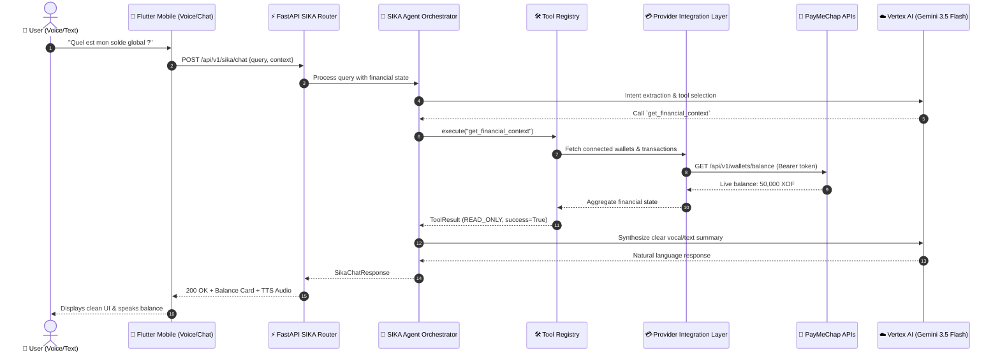
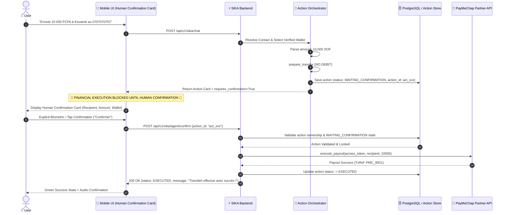

# SIKA — Autonomous Personal Financial Agent for Mobile Money

> **Google Cloud "All Things Agentic" Hackathon — Track: Taskmaster**  
> An autonomous, secure, and multi-wallet agentic financial assistant designed for West Africa (Côte d'Ivoire & WAEMU region).

---

## 🌍 The Problem

In West Africa, **Mobile Money is the backbone of financial inclusion**, powering daily transactions for tens of millions of people. However, users face critical real-world friction:

- **Extreme Fragmentation**: Users navigate between multiple separate providers (**Wave, Orange Money, MTN MoMo, PayMeChap, Djamo**).
- **Zero Unified Visibility**: Checking overall balances or reviewing weekly expenses requires opening 3 to 5 separate mobile applications and entering multiple PINs.
- **Accidental & Erroneous Transfers**: Typing errors in phone numbers or selecting the wrong wallet lead to irreversible financial loss.
- **Cognitive Load & Inaccessibility**: Manual calculations, financial jargon, and complex user interfaces exclude non-tech-savvy users and oral-first communities.

---

## 💡 The SIKA Solution

**SIKA** is an **Autonomous Personal Financial Agent** acting as an intelligent co-pilot across Mobile Money accounts.

Unlike standard chatbots, SIKA:
- 🎙️ **Understands Natural Voice & Text**: Speaks and listens in Ivorian and West African French contexts.
- 🔗 **Aggregates Multi-Wallet Balances**: Fetches verified balances and transaction streams into a unified real-time financial context.
- 📊 **Performs Autonomous Financial Analysis**: Computes category spending breakdowns, detects anomalies, and estimates cash runway.
- 🛡️ **Executes Safe Multi-Step Financial Actions**: Resolves recipient contacts, selects the optimal verified wallet, prepares transactions, and enforces a mandatory **Human-in-the-Loop Confirmation Gate** before any financial execution.

---

## 🤖 Why SIKA is Truly Agentic (Agent vs. Chatbot)

| Feature | Standard Financial Chatbot | SIKA Agentic Assistant |
|---|---|---|
| **Goal Reasoning** | Keyword matching or single-prompt completion | Multi-turn planning, goal decomposition, and state tracking |
| **Tool Execution** | Cannot interact with external systems | Deterministic tool selection via a strictly typed Tool Registry |
| **Financial State** | Stateless; prone to hallucinations | Backed by server-side persistent state, audit trails, and DB locks |
| **Safety & Verification** | Risks unauthorized or hallucinated actions | Strict 3-tier risk levels (`READ_ONLY`, `CONFIRMATION_REQUIRED`, `EXECUTION`) |
| **Execution Control** | Direct invocation or uncontrolled output | Mandatory server-side `WAITING_CONFIRMATION` barrier with biometrics |
| **Resilience** | Fails completely if cloud AI is unreachable | Resilient multi-tier architecture with deterministic local fallback |

---

## 💳 Demo Environment — PayMeChap

**PayMeChap** is a Mobile Money platform developed by the project author.

### Integration Relationship

**SIKA integrates PayMeChap as a financial provider and consumes PayMeChap APIs.**

```
┌───────────────────────────────────────────────────────────┐
│                           SIKA                            │
│               Autonomous Financial Agent                  │
└─────────────────────────────┬─────────────────────────────┘
                              │
                              │ API Calls (OAuth2 Token / HTTPS)
                              ▼
┌───────────────────────────────────────────────────────────┐
│                      PayMeChap APIs                       │
│    ├── Authentication (Partner Access Token)              │
│    ├── Wallet Information (account number, identity)      │
│    ├── Live Balances (XOF)                                │
│    ├── Live Transactions (30-day stream)                  │
│    └── Financial Operations (Payout execution)            │
└───────────────────────────────────────────────────────────┘
```

- **SIKA consumes PayMeChap APIs** through a dedicated provider integration layer (`paymechap_api_service`).
- **Controlled & Reproducible Demo**: Third-party providers (Wave, Orange Money, MTN) require individual consumer accounts, specific hardware enrollment, or proprietary operator approvals. Hackathon judges and reviewers **should NOT** be expected to connect personal Mobile Money accounts or create third-party credentials.
- **PayMeChap provides a verified, live API environment** that allows the complete SIKA agentic workflow (balance perception, transaction analysis, transfer preparation, and live payout execution) to be demonstrated and reproduced reliably.

### Financial Provider Status Table

| Provider | Status | Role in Demo |
|---|---|---|
| **PayMeChap** | 🟢 **VERIFIED** | **Live financial provider used for demonstration** (real partner OAuth2 token, live balance retrieval, 30-day transaction stream, and real payout execution) |
| **Wave** | 🟡 **NOT VERIFIED** | Not used as a live provider (enrolled wallet structure supported; execution strictly blocked without live API credentials) |
| **Orange Money** | 🟡 **NOT VERIFIED** | Not used as a live provider (requires explicit user clarification; no mock execution) |
| **MTN Mobile Money** | 🟡 **NOT VERIFIED** | Not used as a live provider (no silent fallback; honest rejection of unavailable credentials) |

> 🔒 **Security Principle**: SIKA deliberately refuses to use unavailable credentials or invent financial data. If a provider is not verified for live execution, SIKA informs the user and asks for clarification. This is an intentional **Security Feature**, not a limitation.

---

## 🔄 End-to-End Workflows

### 1. General Financial Query & Perception Flow



---

### 2. Safe Financial Transfer Flow (Human-in-the-Loop Gate)



---

## 🏛️ System Architecture

```
                    ┌───────────────────────────────┐
                    │             USER              │
                    │         (Voice / Text)        │
                    └───────────────┬───────────────┘
                                    │
                                    ▼
                    ┌───────────────────────────────┐
                    │    SIKA Mobile (Flutter)      │
                    │   • Orbital Voice UI / STT    │
                    │   • Human Confirmation Cards  │
                    │   • Android Foreground Service│
                    └───────────────┬───────────────┘
                                    │ HTTP / REST (JWT Auth)
                                    ▼
                    ┌───────────────────────────────┐
                    │     FastAPI SIKA Router       │
                    │   (/api/v1/sika/*, /health)   │
                    └───────────────┬───────────────┘
                                    │
                                    ▼
                    ┌───────────────────────────────┐
                    │   SIKA Agent Orchestrator     │
                    │  • Goal & Multi-Turn State    │
                    │  • Vertex AI (Gemini 3.5)     │
                    │  • Deterministic Local Engine │
                    └───────────────┬───────────────┘
                                    │
                                    ▼
                    ┌───────────────────────────────┐
                    │     Tool Registry (3 Tiers)   │
                    │  READ_ONLY | CONFIRM | EXEC   │
                    └───────┬───────┬───────┬───────┘
                            │       │       │
             ┌──────────────┘       │       └──────────────┐
             ▼                      ▼                      ▼
    ┌─────────────────┐   ┌───────────────────┐   ┌─────────────────┐
    │  Balance Tools  │   │ Transaction Tools │   │ Transfer Tools  │
    └────────┬────────┘   └─────────┬─────────┘   └────────┬────────┘
             │                      │                      │
             └──────────────────────┼──────────────────────┘
                                    ▼
                    ┌───────────────────────────────┐
                    │   Provider Integration Layer  │
                    │   (paymechap_api_service.py)  │
                    └───────────────┬───────────────┘
                                    │ HTTPS (Partner OAuth2 Token)
                                    ▼
                    ┌───────────────────────────────┐
                    │        PayMeChap APIs         │
                    │     (Mobile Money Backend)    │
                    └───────────────┬───────────────┘
                                    │
                                    ▼
                            Financial Result
                                    │
                                    ▼
                    ┌───────────────────────────────┐
                    │         SIKA Response         │
                    │     ┌─────────┴─────────┐     │
                    │     ▼                   ▼     │
                    │ Voice (TTS)         UI (HITL) │
                    └───────────────────────────────┘
```

---

## 🛠️ Financial Tool Registry

SIKA's Tool Registry enforces strict type-safe execution and deterministic risk levels:

| Tool Name | Risk Level | Description | Confirmation Required |
|---|---|---|---|
| `get_financial_context` | `READ_ONLY` | Aggregates all connected wallets, live balances, and 30-day transaction history | ❌ No |
| `get_wallet_balance` | `READ_ONLY` | Fetches live balance for a specific enrolled provider | ❌ No |
| `get_total_balance` | `READ_ONLY` | Calculates the real-time total net worth across verified wallets | ❌ No |
| `get_recent_transactions`| `READ_ONLY` | Retrieves filtered transactions (up to 30 days) from connected wallets | ❌ No |
| `get_spending_summary` | `READ_ONLY` | Categorizes and aggregates debits across categories (Food, Transport, Utilities) | ❌ No |
| `search_contact` | `READ_ONLY` | Resolves recipient name to phone number (no fake contacts permitted) | ❌ No |
| `prepare_transfer` | `CONFIRMATION_REQUIRED` | Validates wallet & amount, creates `action_id`, locks state in `WAITING_CONFIRMATION` | ⚠️ **Yes (Mandatory)** |
| `confirm_action` | `EXECUTION` | Verifies server-side action ownership and triggers live payout via PayMeChap API | 🔒 **Yes (Biometric / PIN)** |
| `cancel_action` | `EXECUTION` | Safely revokes and cancels a pending `WAITING_CONFIRMATION` action | ❌ No |

---

## 🛡️ Safety & Human-in-the-Loop (HITL)

Financial integrity is SIKA's highest priority:

1. **No Execution Before Confirmation**: `prepare_transfer` **never** debits funds. It only creates an immutable server-side action with a unique `action_id`.
2. **Server-Side State Persistence**: The action is stored in the database with status `WAITING_CONFIRMATION`. Client payloads cannot modify the amount or recipient at confirmation time.
3. **User Isolation & Multi-Tenancy**: Users can only confirm, inspect, or cancel their own actions. Cross-user action hijacking is strictly rejected (HTTP 403).
4. **Idempotency & Anti-Replay**: Once an action is executed, subsequent confirmation attempts return `ALREADY_EXECUTED` without duplicate execution.
5. **No Contact Hallucination**: If a recipient is unknown or ambiguous, SIKA asks for clarification instead of inventing phone numbers.
6. **30-Day Transaction Boundary**: Old transactions (> 30 days) are automatically filtered out from spending calculations to prevent skewed advice.

---

## ☁️ Google Cloud & Vertex AI Integration

SIKA leverages Google Cloud infrastructure throughout its lifecycle:

- **Vertex AI (Gemini 3.5 Flash)**: Primary LLM accessed via the official `google-genai` Python SDK for natural language reasoning, intent extraction, and response synthesis.
- **Deterministic Local Fallback**: When operating offline or with constrained connectivity, SIKA seamlessly activates its local deterministic reasoning engine, ensuring 100% uptime for core financial queries and transfer preparations.
- **Google Cloud SQL & Memorystore**: Configured production infrastructure (`sika-db-instance` PostgreSQL and `sika-redis-instance`).
- **Google Cloud Run**: Containerized production deployment.

---

## 🗄️ Database & Redis Infrastructure

### Database Layer
- **PostgreSQL**: Production database engine using SQLAlchemy 2.0+ and Alembic migrations.
- **SQLite Local Fallback**: In local development without PostgreSQL, `database.py` automatically falls back to local SQLite (`sika_local.db`).

### Redis Layer
- **Status**: **ACTIVE when configured, with transparent IN-MEMORY FALLBACK for local demo**.
- **Role**: Redis is used for distributed rate limiting, anti-replay OTP sessions, and real-time JWT token revocation (logout deny-list).
- **Fallback**: When Redis is not running locally, `create_security_store()` and `wallet_router.py` automatically utilize thread-safe in-memory stores.

---

## 🧰 Technology Stack

| Layer | Technology | Version / Specification |
|---|---|---|
| **Mobile Frontend** | Flutter / Dart | Flutter 3.x, Dart 3.x |
| **Mobile Architecture**| Riverpod, Flutter Animate, Glassmorphism | State management & UI animations |
| **Android Native** | Kotlin | Foreground Service, MethodChannel bridge |
| **Backend Framework** | FastAPI (Python) | Python 3.11+, Pydantic v2, Uvicorn |
| **AI / Cloud LLM** | Google Vertex AI | `google-genai` SDK, Gemini 3.5 Flash |
| **Database & ORM** | PostgreSQL / SQLite | SQLAlchemy 2.0+, Alembic Migrations |
| **Caching & Security** | Redis / In-Memory | Distributed Rate Limiting & Token Deny-list |
| **Containerization** | Docker & Docker Compose | Multi-stage slim image, non-root `appuser` |
| **Testing** | pytest, pytest-asyncio | 115 comprehensive automated tests |

---

## 📂 Project Structure

```
.
├── docker-compose.yml              # Fast development / demo Docker Compose setup
├── Dockerfile                      # Production container definition (non-root appuser)
├── .dockerignore                   # Build artifact exclusions
├── README.md                       # Comprehensive project documentation
├── docs/                           # Architecture audits, guides & demo scenarios
├── backend/                        # FastAPI Agentic Backend
│   ├── Dockerfile                  # Container definition
│   ├── requirements.txt            # Python dependencies (FastAPI, google-genai, etc.)
│   ├── alembic/                    # Database migration scripts
│   ├── app/
│   │   ├── main.py                 # Application factory & lifespan
│   │   ├── config.py               # Pydantic Settings & environment variables
│   │   ├── database.py             # SQLAlchemy session & SQLite fallback
│   │   ├── models/                 # Database models (User, Wallet, Action, Goal)
│   │   ├── routes/                 # API endpoints (sika_router, wallet_router, etc.)
│   │   ├── schemas/                # Pydantic DTOs & response contracts
│   │   ├── services/               # Auth, AI Engine, PayMeChap API, Security Store
│   │   └── agent/                  # SIKA Agent Core
│   │       ├── orchestrator.py     # Agent reasoning loop & action lifecycle
│   │       ├── tool_registry.py    # Deterministic tool registry with risk levels
│   │       └── tools/              # Financial, wallet, and transaction tools
│   └── tests/                      # Automated test suites (P0-1 to P0-7, Security)
└── mobile/                         # Flutter Mobile Application
    ├── pubspec.yaml                # Flutter packages & dependencies
    ├── android/                    # Android native services (Wake-word, Manifest)
    └── lib/
        ├── main.dart               # App entry point
        ├── core/                   # Design system (Colors, Spacing, Glass widgets)
        └── features/               # AI Assistant, Wallets, Profile, Auth
```

---

## 🚀 Quick Start

### A. Backend with Docker Compose (Recommended for Reviewers)

```bash
# 1. Clone repository
git clone https://github.com/dav9fulldev/sika-agent.git
cd sika-agent

# 2. Build and start backend
docker compose up --build
```

The backend starts on `http://localhost:8080` (and `http://localhost:8001`).

Verify health probes:
```bash
curl http://localhost:8080/health
# {"status":"healthy","environment":"development","version":"1.0.0"}

curl http://localhost:8080/api/v1/sika/health
# {"status":"ready","service":"Sika AI Standalone API","provider":"VERTEX_AI","model":"gemini-3.5-flash"}
```

To stop containers:
```bash
docker compose down
```

---

### B. Backend Local Run (Without Docker)

```bash
cd backend

# Create and activate virtual environment
python3 -m venv venv
source venv/bin/activate

# Install dependencies
pip install -r requirements.txt

# Start backend server
uvicorn app.main:app --host 0.0.0.0 --port 8001 --reload
```

---

### C. Mobile Application (Flutter)

```bash
cd mobile

# Install dependencies
flutter pub get

# Run static analysis
flutter analyze

# Launch on connected Android device or emulator
flutter run
```

#### Android Emulator Connectivity Note
When running in an Android emulator, connect to the backend using Android's loopback bridge:
- **Emulator backend URL**: `http://10.0.2.2:8001`
- **Physical Device**: `http://<YOUR_LOCAL_IP>:8001`

*(Mobile containerization is intentionally omitted because Flutter mobile apps require native Android toolchains, emulator virtualization, and hardware audio drivers).*

---

## 📡 Active API Endpoints

| Method | Endpoint | Description | Auth Required |
|---|---|---|---|
| `GET` | `/health` | Liveness and readiness healthcheck probe | No |
| `GET` | `/api/v1/sika/health` | SIKA AI engine and Vertex AI status probe | No |
| `POST` | `/api/v1/sika/chat` | Main conversational and voice processing entrypoint | Yes (JWT) |
| `POST` | `/api/v1/sika/agent/confirm` | **Human confirmation gate**: Executes prepared financial action | Yes (JWT) |
| `POST` | `/api/v1/sika/agent/cancel` | Cancels a pending `WAITING_CONFIRMATION` action | Yes (JWT) |
| `GET` | `/api/v1/wallets/me` | Retrieves user's connected wallets & live balances | Yes (JWT) |
| `POST` | `/api/v1/wallets/connect` | Initiates wallet connection (OTP challenge) | Yes (JWT) |
| `POST` | `/api/v1/wallets/verify-otp` | Verifies OTP code and enrolls wallet in DB | Yes (JWT) |
| `POST` | `/api/v1/sika/auth/login` | Authenticates user and issues OAuth2 Bearer token | Yes (JWT) |
| `POST` | `/api/v1/sika/auth/logout` | Revokes JWT token in real-time deny-list | Yes (JWT) |

---

## 🧪 Testing & Verification Status

Automated testing validates every layer of SIKA's agentic and security architecture:

```bash
cd backend
source venv/bin/activate

# 1. Critical Agent Tools & Financial Pipeline (P0-1 to P0-7)
pytest tests/test_agent_tools.py -v

# 2. Production Security (OWASP, JWT, Dockerfile, Cascades)
pytest tests/test_production_security.py -v

# 3. Authorization & Tenant Isolation
pytest tests/test_authorization_security.py -v

# 4. Anti-Abuse, Rate-Limiting & Session Security
pytest tests/test_abuse_and_session_security.py -v

# 5. Financial Action Reconciliation & Idempotency
pytest tests/test_reconciliation.py -v

# 6. Network Resilience & Timeout Handling
pytest tests/test_network_resilience.py -v

# 7. Wallet Routes Security
pytest tests/test_wallet_routes_security.py -v
```

### Verified Test Results Summary

| Test Suite File | Tests Count | Result | Core Validation Scope |
|---|---|---|---|
| `test_agent_tools.py` | **49 Tests** | **100% PASS** | P0-1 to P0-7 (Enrolled wallets, PayMeChap balance, 30-day filter, amounts, prepare_transfer, confirm) |
| `test_production_security.py` | **21 Tests** | **100% PASS** | OWASP headers, payload limit, non-root Docker user, database cascades, Alembic integrity |
| `test_reconciliation.py` | **12 Tests** | **100% PASS** | Unknown result handling, financial reconciliation, zero duplicate execution |
| `test_authorization_security.py` | **10 Tests** | **100% PASS** | Multi-tenant isolation, cross-user action hijack prevention, JWT expiry |
| `test_abuse_and_session_security.py` | **7 Tests** | **100% PASS** | Anti-replay OTP, 3-attempt OTP lockout, PIN brute-force, token logout revocation |
| `test_network_resilience.py` | **7 Tests** | **100% PASS** | HTTP 500 handling, read timeouts, connection errors, deterministic fallback |
| `test_wallet_routes_security.py` | **4 Tests** | **100% PASS** | Unauthenticated rejection, user ID spoofing prevention, wallet isolation |
| `test_learning_backup.py` | **3 Tests** | **100% PASS** | User learning service and backup persistence |
| `test_mcp_architecture.py` | **2 Tests** | **100% PASS** | MCP server configurations and specialized agent registries |
| **Total Automated Tests** | **115 Tests** | **100% PASS** | Full backend test suite passing cleanly |
| **Flutter Mobile Analyze** | **0 Issues** | **100% PASS** | Static analysis, Riverpod typing, null safety |

---

## 🎬 Recommended 4-Minute Hackathon Demo

1. **Financial Health & Aggregate Balance**:
   - Voice/Text prompt: *"Sika, quel est mon solde global ?"*
   - SIKA inspects all enrolled accounts via `get_financial_context` and provides an immediate unified balance across Mobile Money providers.
2. **Proactive Spending & Runway Analysis**:
   - Voice/Text prompt: *"Analyse mes dépenses de ce mois et dis-moi si je peux économiser."*
   - SIKA analyzes 30-day categorized debits, highlights food/transport expenses, and calculates runway.
3. **Contact Resolution & Clarification (Security Test)**:
   - Voice/Text prompt: *"Envoie 5000 à David."*
   - SIKA detects multiple contacts or missing info, safely asking: *"À quel numéro de David souhaites-tu envoyer 5 000 FCFA ?"* (Zero hallucination).
4. **Autonomous Transfer Preparation (Human-in-the-Loop)**:
   - Voice/Text prompt: *"Envoie 10 000 FCFA à Kouamé au 0707070707 depuis PayMeChap."*
   - SIKA parses the amount, selects the verified PayMeChap wallet, executes `prepare_transfer`, and displays the **Human Confirmation Card** in `WAITING_CONFIRMATION` state.
5. **Biometric Confirmation & Real Payout**:
   - User reviews the card and taps **"Confirmer"**.
   - SIKA calls `/agent/confirm`, executes the payout via the live PayMeChap partner API, and confirms completion with an updated balance!

---

## 🏆 Hackathon Alignment — Taskmaster Track

SIKA directly fulfills the goals of the **Taskmaster Track**:
- 🎯 **End-to-End Task Execution**: Moves from ambiguous natural language user requests all the way to verified financial execution.
- 🧩 **Deterministic Tool Orchestration**: Eliminates hallucination risks by anchoring LLM reasoning in deterministic Python tools.
- 🛡️ **Safe Autonomous Systems**: Implements state-machine guarantees where sensitive actions cannot proceed without explicit human authorization.
- 💡 **Real-World Impact**: Solves financial fragmentation for millions of Mobile Money users across West Africa.

---

## 📄 License & Team

Built with ❤️ by the SIKA Engineering Team for the **Google Cloud All Things Agentic Hackathon**.
